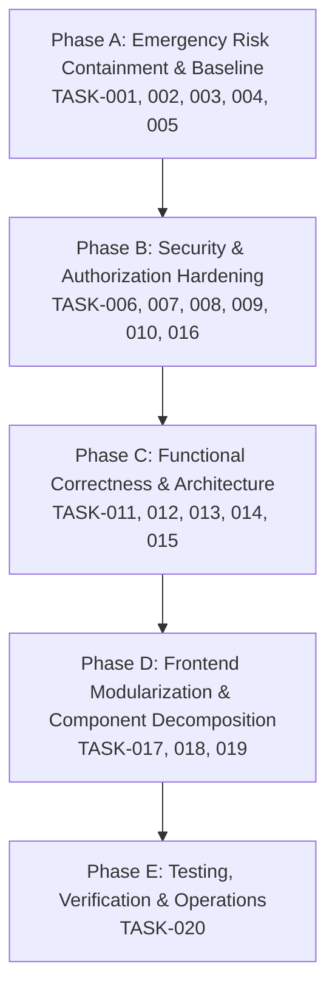

# Comprehensive Codebase Audit & Improvement Roadmap: Coaching Management System (CMS)

**Document Name:** `PROJECT_AUDIT_AND_IMPROVEMENT_ROADMAP.md`  
**Auditor Roles:** Principal Software Engineer, Senior Software Architect, Application Security Reviewer, Code Quality Auditor  
**Audit Date:** October 19, 2026  
**Target Codebase:** Coaching Management System (CMS) — Monorepo (`backend/` & `frontend/`)  
**Status:** Audit Completed — Implementation Ready  

---

## 1. Executive Summary

### 1.1 System Overview & Architecture
The **Coaching Management System (CMS)** is a multi-branch web application designed for academic coaching institutes. It manages multi-branch academic hierarchies, public landing pages with course catalogs, student admissions, batch scheduling, attendance logs, offline exam marksheet grading with rank assignment, financial invoicing, payment collection vouchers, operating expense logs, digital study materials, and student referral reward payouts.

The application is structured as a decoupled two-tier repository:
- **Backend (`backend/`):** Node.js 22, Express 4.21, TypeScript 5.7, Prisma ORM 6.4 connecting to Supabase PostgreSQL (via transaction and session poolers), JWT authentication, Zod request validation, Multer file upload with Supabase Storage and local fallback.
- **Frontend (`frontend/`):** React 18.3, Vite 6.1, TypeScript 5.7, Tailwind CSS 3.4 using a centralized 5-variable theme engine (`--bg-app`, `--surface`, `--text-main`, `--brand-primary`, `--accent`), Lucide icons, Sonner toast notifications, React Router DOM 6.28.

### 1.2 Overall Codebase Health Assessment
- **Architecture Integrity:** **Moderate (6/10)**. Good domain separation in backend modules (`modules/auth`, `modules/admin`, `modules/batches`, `modules/finance`, `modules/academic-ops`), but marred by architectural violations (direct Prisma queries in controllers, lack of service boundary isolation, missing shared API client).
- **Security & Authorization:** **Poor to At-Risk (4/10)**. Hardcoded JWT fallback secrets in configuration, lack of file-type whitelisting and memory-buffer DoS in upload pipeline, IDOR vulnerabilities in notice/study-material/expense deletion, lack of client-side role guards on `/admin` and `/student` routes, and instant unmoderated public testimonial publishing.
- **Data Integrity & Concurrency:** **Critical Risk (3/10)**. Roll numbers, invoice numbers, and payment receipt numbers are generated via sequential `prisma.count()` queries without database transactions or row-level locking, causing collisions and transaction crashes under concurrent user actions. In admission verification, financial record creation is wrapped in a catch block that swallows errors, confirming students without generating ledger records.
- **Frontend Quality & Maintainability:** **Moderate (5/10)**. Clean visual aesthetic following boxy low-radius styling. However, there is a total violation of architectural rule ADR-004: TanStack Query is completely absent, replaced by raw `fetch()` calls in component-level `useEffect` hooks across all 20+ pages. Massive "God Components" (1,000–1,850 lines) mix multiple tabs, dialog states, and inline form logic. Monolithic 750 kB production JS bundle without route-level code-splitting.
- **Verification & Testing Infrastructure:** **Non-Existent (1/10)**. Zero unit tests, zero integration tests, zero end-to-end tests, zero linting or formatting configs (ESLint/Prettier missing). No Git repository initialized.

### 1.3 Key Confirmed Defects & Urgent Priorities
1. **Critical Concurrency Collisions:** Duplicate roll number and invoice number generation under race conditions (`AUD-003`, `AUD-004`).
2. **Insecure File Upload & Memory DoS:** 50MB in-memory buffer with no file extension whitelist, allowing arbitrary file uploads including executable or scriptable formats (`AUD-002`).
3. **Hardcoded Fallback JWT Secrets:** If environment variables are missing, backend falls back to predictable hardcoded secrets in production (`AUD-001`).
4. **Session Expiry & Broken Token Lifecycle:** 15-minute access tokens with no refresh token rotation endpoint or client interceptor, abruptly terminating active user sessions (`AUD-005`).
5. **IDOR & Missing Authorization Checks:** Branch administrators can delete study materials, public notices, and expense records belonging to other branches or global scopes (`AUD-007`).
6. **Double-Spending Referral Payout Race Condition:** Simultaneous withdrawal requests bypass available balance calculations (`AUD-009`).
7. **Mock Data on Executive Dashboard:** The main admin dashboard displays hardcoded static numbers rather than calling the existing metrics API (`AUD-010`).

---

## 2. Project Inventory and Architecture

### 2.1 Technology Stack & Observed Versions

| Component | Technology | Version | Purpose |
| :--- | :--- | :--- | :--- |
| **Backend Runtime** | Node.js | v22+ (ES Modules) | Server execution environment |
| **Backend Framework** | Express.js | ^4.21.2 | REST API routing and middleware |
| **Database ORM** | Prisma Client & CLI | ^6.4.1 | Schema migrations and database queries |
| **Database Engine** | PostgreSQL (Supabase) | 15+ | Transaction pooling (port 6543) & Session pooling (port 5432) |
| **Validation** | Zod | ^3.24.2 | Schema validation for HTTP payloads |
| **Authentication** | JWT (`jsonwebtoken`) + `bcryptjs` | 9.0.2 / 2.4.3 | Token creation, signing, and password hashing |
| **File Handling** | Multer + `@supabase/supabase-js` | 2.4.0 / 2.118.0 | File uploads to Supabase storage bucket or local disk |
| **Security Headers** | Helmet + CORS | 8.0.0 / 2.8.5 | Cross-origin policies and HTTP headers |
| **Frontend Framework** | React + TypeScript | ^18.3.1 / ^5.7.3 | Single-page client application |
| **Build Tooling** | Vite | ^6.1.0 | Fast HMR dev server and Rollup production bundler |
| **Styling** | Tailwind CSS + PostCSS | ^3.4.17 / ^8.5.2 | Utility-first styling with custom CSS variables |
| **Routing** | React Router DOM | ^6.28.2 | Client-side routing and layout hierarchies |
| **UI Notifications** | Sonner | ^2.0.1 | Toast notifications with immediate close button |
| **Icons** | Lucide React | ^0.475.0 | Modern SVG iconography |

### 2.2 Directory Map & Responsibilities

```
cms/
├── memory.md                            # Persistent ADR ledger & completed milestones
├── rules.md                             # Architectural standards & zero-duplication rules
├── database_structure.md                # Schema definitions, ER diagrams & index strategy
├── backend/
│   ├── package.json                     # Express dependencies and scripts
│   ├── tsconfig.json                    # ES2022 / NodeNext TypeScript config
│   ├── .env.example                     # Environment template (incomplete)
│   ├── prisma/
│   │   ├── schema.prisma                # 20+ models (Users, Batches, Invoices, Exams, etc.)
│   │   └── seed.ts                      # Database seeder (Demo institution, branches, accounts)
│   └── src/
│       ├── app.ts                       # Express app factory, CORS, Helmet, static route mounting
│       ├── server.ts                    # Entrypoint listening on PORT
│       ├── config/                      # env.ts, prisma.ts
│       ├── common/                      # appError.ts, apiResponse.ts
│       ├── middleware/                  # authGuard, roleGuard, branchContext, validateRequest, errorHandler
│       ├── schemas/                     # Shared Zod validation schemas
│       ├── types/                       # Domain enums & API response interfaces
│       └── modules/
│           ├── auth/                    # Login, self-registration, me profile
│           ├── admin/                   # Branch, staff, faculty, student CRUD, metrics
│           ├── batches/                 # Batches, classes, courses, roster, study materials
│           ├── finance/                 # Invoicing, fee structures, payment collection, costing
│           ├── academic-ops/            # Notice board, exams, marksheet grading, referral payouts
│           ├── public/                  # Landing page data aggregator, reviews, inquiries
│           ├── students/                # Student dashboard, profile edit, password change
│           └── upload/                  # Asset upload to Supabase bucket or local disk
└── frontend/
    ├── package.json                     # Vite & React dependencies
    ├── tsconfig.json                    # Bundler module resolution config
    ├── tailwind.config.ts               # 5-variable theme engine and boxy low-radius borders
    └── src/
        ├── main.tsx                     # React DOM root mounting
        ├── App.tsx                      # Route declarations across Public, Admin, and Student
        ├── index.css                    # CSS tokens (:root, .dark, boxy border rules)
        ├── types/                       # Frontend domain interfaces mirroring backend
        ├── lib/                         # theme.ts (Light/Dark mode hook)
        ├── components/
        │   ├── ui/                      # SonnerToaster.tsx
        │   ├── common/                  # FileUpload.tsx
        │   └── modals/                  # PrintableReceiptModal, StudentIdCardModal, PrintableScorecardModal
        ├── layouts/                     # PublicLayout, AdminLayout, StudentLayout
        └── modules/
            ├── auth/                    # LoginPage, RegisterPage
            ├── public/                  # LandingPage, BatchDetailsPage
            ├── admin/                   # 12 Administrative management desk pages
            └── student/                 # 6 Student portal self-service pages
```

### 2.3 Execution Flow Tracing
1. **User Action / API Request:** Client triggers an action (e.g., student admission, fee payment).
2. **Transport & Gatekeeping:** HTTP request hits Express in `app.ts` -> CORS checks origin -> Helmet adds security headers -> `authGuard` verifies Bearer JWT -> `roleGuard` validates `req.user.role` -> `branchContext` attaches accessible branch IDs -> `validateRequest` parses body through Zod.
3. **Controller Execution:** Controller extracts parameters, delegates to `<module>.service.ts`, and passes DTOs to `ResponseUtil.success`.
4. **Service & Database Access:** Service executes business logic, calls `prisma.<model>`, performs transactions via `prisma.$transaction`, and returns data.
5. **Client Response & Consumption:** React receives `ApiResponse<T>`, unwraps data, and triggers local component re-renders.

---

## 3. Audit Coverage and Limitations

### 3.1 Inspected Areas
- **Backend Core:** All configuration files (`package.json`, `tsconfig.json`, `env.ts`, `prisma.ts`, `app.ts`, `server.ts`).
- **Backend Middleware:** All middleware (`authGuard.ts`, `roleGuard.ts`, `branchContext.ts`, `validateRequest.ts`, `errorHandler.ts`).
- **Backend Modules:** All 8 modules: routes, controllers, services, schemas, and types.
- **Database Schema & Migrations:** `prisma/schema.prisma` (all 711 lines, 20 models, 13 enums, composite indexes) and `prisma/seed.ts` (all 779 lines).
- **Frontend Architecture:** `package.json`, `tsconfig.json`, `tailwind.config.ts`, `index.css`, `theme.ts`, `App.tsx`, `main.tsx`.
- **Frontend Layouts & Components:** All 3 layouts (`PublicLayout`, `AdminLayout`, `StudentLayout`), all common components, all 3 printable modals.
- **Frontend Feature Modules:** All 12 admin pages, all 6 student pages, 2 auth pages, and 2 public pages (totaling 17,036 lines of TypeScript/TSX).

### 3.2 Verification Commands Executed
- `backend/npx tsc --noEmit`: Exited with code 0 (TypeScript static type check passed).
- `frontend/npx tsc -b`: Exited with code 0 (TypeScript build check passed).
- `frontend/npx vite build`: Exited with code 0. Warning generated: Chunks larger than 500 kB (`dist/assets/index-BpsQYJlj.js` is 750.26 kB).
- File inventory, line count, and pattern grep searches executed across entire repository.

### 3.3 Limitations and Unverified Areas
- **Runtime Supabase Connection:** Live database credentials were not queried against external Supabase hosts during this read-only audit to avoid network egress or data mutation.
- **External Storage Integration:** Supabase Storage upload was verified through code inspection of `UploadService`; live file delivery from cloud bucket was not tested against live endpoints.
- **Production Server Environment:** Performance measurements under high concurrency are based on architectural analysis and code profiling rather than load-testing benchmarks.

---

## 4. Critical Findings (Urgent Remediation Required)

---

### AUD-001: Insecure Hardcoded Fallback Secrets for JWT Signing
- **ID:** AUD-001  
- **Title:** Insecure Hardcoded Fallback Secrets for JWT Signing in Environment Configuration  
- **Category:** Security  
- **Severity:** Critical  
- **Confidence:** Confirmed  
- **Evidence:** `backend/src/config/env.ts` (Lines 11–14):
  ```typescript
  JWT_ACCESS_SECRET: process.env.JWT_ACCESS_SECRET || "cms_default_access_secret_12345",
  JWT_REFRESH_SECRET: process.env.JWT_REFRESH_SECRET || "cms_default_refresh_secret_12345",
  ```
- **Observed Behavior:** If `JWT_ACCESS_SECRET` or `JWT_REFRESH_SECRET` is not provided in `.env`, the server defaults to known, publicly committed strings.
- **Expected Behavior:** In production or non-test environments, the server must throw an immediate startup error if cryptographic secrets are missing. Secrets must never have default hardcoded values.
- **Impact:** An attacker who knows the default strings can forge arbitrary JWT access tokens with `role: SUPER_ADMIN` and gain complete administrative control over the entire system.
- **Root Cause:** Placeholder defaults left in source code during early development without strict startup validation.
- **Recommended Fix:** Enforce runtime validation in `env.ts` using Zod. Prevent server startup in production if `JWT_ACCESS_SECRET` or `DATABASE_URL` is undefined or matches known insecure defaults.
- **Dependencies:** None.
- **Verification:** Run `NODE_ENV=production node dist/server.js` with unset `JWT_ACCESS_SECRET`; verify process immediately terminates with an informative configuration error.
- **Regression Risks:** None.

---

### AUD-002: Insecure File Upload Pipeline with Memory Storage DoS, Missing Type Whitelist & Stored XSS
- **ID:** AUD-002  
- **Title:** Insecure File Upload Pipeline with Memory Storage DoS, Missing Type Whitelist & Stored XSS Risk  
- **Category:** Security / Reliability  
- **Severity:** Critical  
- **Confidence:** Confirmed  
- **Evidence:** 
  1. `backend/src/modules/upload/upload.routes.ts` (Lines 11–16):
     ```typescript
     const upload = multer({
       storage: multer.memoryStorage(),
       limits: { fileSize: 50 * 1024 * 1024 }, // 50MB
     });
     ```
  2. `backend/src/modules/upload/upload.service.ts` (Lines 31–38, 70–82):
     ```typescript
     const ext = path.extname(file.originalname).toLowerCase();
     // No extension or mime-type validation whatsoever
     ```
  3. `backend/src/app.ts` (Line 38):
     ```typescript
     app.use("/uploads", express.static(path.resolve(process.cwd(), "uploads")));
     ```
- **Observed Behavior:** The endpoint accepts files up to 50MB held entirely in Node.js RAM buffers. No MIME-type or file extension validation is performed. Files saved to the local fallback directory are served via `express.static` with cross-origin resource policy enabled.
- **Expected Behavior:** File uploads must validate both MIME type and file extension against strict whitelists (e.g., images: `image/jpeg`, `image/png`, `image/webp`; documents: `application/pdf`). Memory buffer limits must be restricted (max 5MB for images, 15MB for documents), or disk streaming should be used. Files served directly must have strict `Content-Disposition: attachment` or sandboxed headers to prevent script execution.
- **Impact:** 
  1. **Denial of Service (DoS):** Multiple concurrent 50MB uploads will exhaust the Node.js V8 heap and crash the API process.
  2. **Stored Cross-Site Scripting (XSS):** Any authenticated user can upload an HTML file or SVG containing malicious JavaScript. When an administrator or student accesses the file URL, the script executes in their browser session.
- **Root Cause:** Rapid prototyping using default Multer configuration without security constraints or file validation.
- **Recommended Fix:**
  - Add file filter in Multer to reject any file whose extension or MIME type is not explicitly whitelisted.
  - Reject dangerous extensions: `.html`, `.htm`, `.svg`, `.exe`, `.sh`, `.js`, `.php`.
  - Reduce max upload size to 10MB.
  - Set `Content-Security-Policy: default-src 'none'` and `X-Content-Type-Options: nosniff` on `/uploads` static file delivery.
- **Dependencies:** `UploadService`, `FileUpload.tsx`.
- **Verification:** Attempt uploading a `.html` file with JavaScript; verify the endpoint returns HTTP 400 Bad Request.
- **Regression Risks:** Legitimate documents with uncommon extensions could be rejected if the whitelist is too strict.

---

### AUD-003: Race Conditions & Unique Constraint Violations in Number Generation
- **ID:** AUD-003  
- **Title:** Race Conditions and Unique Constraint Violations in Student Roll, Invoice, and Receipt Number Generation  
- **Category:** Logic / Data Integrity  
- **Severity:** Critical  
- **Confidence:** Confirmed  
- **Evidence:** 
  1. `backend/src/modules/auth/auth.service.ts` (Lines 93–97):
     ```typescript
     const count = await prisma.studentProfile.count({
       where: { user: { branchId: input.branchId } },
     });
     const rollNumber = `${year}-${branch.code}-${String(count + 1).padStart(4, "0")}`;
     const referralCode = `REF-${year}-${branch.code}-${String(count + 1).padStart(4, "0")}`;
     ```
  2. `backend/src/modules/admin/admin.service.ts` (Lines 150–154):
     ```typescript
     const count = await prisma.studentProfile.count({
       where: { user: { branchId: input.branchId } },
     });
     rollNumber = `${year}-${branch.code}-${String(count + 1).padStart(4, "0")}`;
     ```
  3. `backend/src/modules/finance/finance.service.ts` (Lines 199–200, 325–326):
     ```typescript
     const count = await prisma.studentInvoice.count();
     const invoiceNumber = `INV-${new Date().getFullYear()}-${String(count + 1001).padStart(5, "0")}`;
     
     const paymentCount = await prisma.paymentTransaction.count();
     const receiptNumber = `RCPT-${new Date().getFullYear()}-${String(paymentCount + 1001).padStart(5, "0")}`;
     ```
- **Observed Behavior:** Identifier sequences rely on non-atomic `prisma.count()` queries executed before inserting records.
- **Expected Behavior:** Identifier generation must be concurrency-safe. Sequential numbers must utilize atomic database sequences, transactional locks, or cryptographically secure pseudo-random unique sequences.
- **Impact:** When two students register or two payments are collected concurrently, both operations compute identical identifiers (`rollNumber`, `invoiceNumber`, `receiptNumber`). Because these fields have `@unique` database constraints, the second transaction crashes with a Prisma P2002 unique constraint violation, failing valid user transactions.
- **Root Cause:** Naive sequential counting assuming single-threaded, isolated database operations.
- **Recommended Fix:** Implement an atomic sequence generator function or append a 4-character cryptographic alphanumeric suffix (or nanoid) to all identifiers, and wrap the generation and creation in a serializable transaction with retry logic.
- **Dependencies:** `AuthService`, `AdminService`, `FinanceService`.
- **Verification:** Simulate 10 simultaneous self-registration requests with Apache Bench or a concurrent Node script; verify all 10 succeed with distinct unique roll numbers.
- **Regression Risks:** Identifier format changes must be reflected in printable receipt and scorecard templates.

---

### AUD-004: Inconsistent Financial State and Swallowed Errors in Admission Payment Verification
- **ID:** AUD-004  
- **Title:** Inconsistent Financial State and Swallowed Errors in Admission Payment Verification  
- **Category:** Business Logic / Data Integrity  
- **Severity:** Critical  
- **Confidence:** Confirmed  
- **Evidence:** `backend/src/modules/batches/batch.service.ts` (Lines 546–578):
  ```typescript
  try {
    const feeAmount = Number(enrollment.paidAmount || enrollment.batch.feeAmount);
    const invoice = await prisma.studentInvoice.create({ ... });
    await prisma.paymentTransaction.create({ ... });
  } catch (err) {
    console.warn("Could not auto-generate invoice record:", err);
  }
  ```
  Lines 553 & 568:
  ```typescript
  invoiceNumber: `INV-${Date.now().toString().slice(-6)}`,
  receiptNumber: `RCPT-${Date.now().toString().slice(-6)}`,
  ```
- **Observed Behavior:** 
  1. The enrollment status is updated to `ACTIVE` outside of any database transaction.
  2. Generation of `invoiceNumber` and `receiptNumber` uses `Date.now().toString().slice(-6)`, which rolls over every 16 minutes and causes frequent collisions.
  3. Invoice and payment creation errors are silently swallowed with `console.warn`.
- **Expected Behavior:** Enrollment status approval, invoice creation, and payment voucher recording must occur inside an atomic `prisma.$transaction`. If invoice or payment creation fails, the entire approval must roll back and return an error. Identifiers must follow standard formatting (`INV-YYYY-XXXXX`, `RCPT-YYYY-XXXXX`).
- **Impact:** Students are marked as confirmed `ACTIVE` seats in a batch, while no student invoice or payment record exists in the financial accounting ledger. The coaching center loses audit trails and revenue records.
- **Root Cause:** Separation of concerns breakdown where financial record creation was treated as an optional side-effect.
- **Recommended Fix:** Wrap `verifyEnrollment` inside `prisma.$transaction(async (tx) => { ... })`. Remove the `try/catch` error swallowing. Use unified, collision-safe identifier generators.
- **Dependencies:** `BatchService`, `FinanceService`.
- **Verification:** Verify admission of a student; confirm that both the `StudentInvoice` and `PaymentTransaction` records are created atomically, or the transaction fails cleanly if data is invalid.
- **Regression Risks:** Existing enrollment records without invoices will need a one-time reconciliation script.

---

### AUD-005: Broken Token Lifecycle: Missing Refresh Mechanism & LocalStorage Exposure
- **ID:** AUD-005  
- **Title:** Broken Token Lifecycle: Missing Refresh Endpoint, 15-Minute Session Abrupt Disconnects & LocalStorage XSS Exposure  
- **Category:** Security / Architecture  
- **Severity:** High  
- **Confidence:** Confirmed  
- **Evidence:** 
  1. `backend/src/config/env.ts` (Line 12): `JWT_ACCESS_EXPIRES_IN: "15m"`.
  2. `backend/src/modules/auth/auth.routes.ts`: Contains only `/login`, `/register-student`, and `/me`. No `/refresh` endpoint exists.
  3. `backend/src/modules/auth/auth.service.ts` (Lines 52–61): Does not return `refreshToken` in `login()` response.
  4. `frontend/src/modules/auth/LoginPage.tsx` (Lines 61–62):
     ```typescript
     localStorage.setItem("cms_token", accessToken);
     localStorage.setItem("cms_user", JSON.stringify(user));
     ```
- **Observed Behavior:** Access tokens expire after 15 minutes. No token refresh endpoint exists, and no client-side interceptor exists to refresh expired tokens. All tokens and user objects are stored in browser `localStorage`.
- **Expected Behavior:** The backend must provide a secure token refresh endpoint (`POST /api/v1/auth/refresh`). The frontend must intercept HTTP 401 responses, silently request a new access token using a refresh token or HTTP-only secure cookie, and resume the failed request without disrupting the user.
- **Impact:** Users are booted out of forms or active workflows every 15 minutes. Because tokens are in `localStorage`, any XSS vulnerability enables complete session hijacking.
- **Root Cause:** Incomplete authentication implementation where refresh tokens were conceived in `User.refreshToken` schema but never wired into routes or client services.
- **Recommended Fix:**
  - Add `POST /api/v1/auth/refresh` endpoint in `auth.routes.ts` and `auth.controller.ts`.
  - Issue refresh tokens via HTTP-only, SameSite cookies.
  - Implement an Axios/Fetch client wrapper in `frontend/src/lib/apiClient.ts` with automatic request retries upon token expiration.
- **Dependencies:** `AuthService`, `frontend` API fetching layer.
- **Verification:** Log into the portal, artificially expire the access token, and verify the client silently refreshes the token and completes background queries.
- **Regression Risks:** Frontend authentication state handling must be updated across layouts.

---

### AUD-006: Missing Client-Side Role Route Guard & Client Domain Isolation Failure
- **ID:** AUD-006  
- **Title:** Missing Client-Side Role Route Guard & Complete Absence of Client Domain Isolation  
- **Category:** Security / Architecture  
- **Severity:** High  
- **Confidence:** Confirmed  
- **Evidence:** 
  1. `frontend/src/App.tsx` (Lines 51–76):
     ```tsx
     {/* Protected Admin Portal */}
     <Route path="/admin" element={<AdminLayout />}> ... </Route>
     {/* Protected Student Portal */}
     <Route path="/student" element={<StudentLayout />}> ... </Route>
     ```
  2. `frontend/src/layouts/AdminLayout.tsx` (Lines 66–71):
     ```tsx
     useEffect(() => {
       const token = localStorage.getItem("cms_token");
       if (!token) navigate("/login");
     }, [navigate]);
     ```
  3. `frontend/src/layouts/StudentLayout.tsx` (Lines 54–60):
     ```tsx
     useEffect(() => {
       const token = localStorage.getItem("cms_token");
       if (!token) navigate("/login");
     }, [navigate]);
     ```
- **Observed Behavior:** `AdminLayout` and `StudentLayout` only check whether *any* token exists in `localStorage`. Neither layout verifies the authenticated user's `role`.
- **Expected Behavior:** As defined in `rules.md` (Section 2, Rule 2): "Admin routes run inside `AdminLayout` protected by `RoleRouteGuard(['SUPER_ADMIN', 'BRANCH_ADMIN'])`. Student routes run inside `StudentLayout` protected by `RoleRouteGuard(['STUDENT'])`."
- **Impact:** Any authenticated student can directly type `/admin` in the browser URL bar and load the entire administrative layout, campus switcher, settings forms, and desk UI. While backend queries return 403, the client UI is completely exposed, leading to confusion, information leakage via cached UI states, and broken user experience.
- **Root Cause:** `RoleRouteGuard` component was documented in architectural specifications (`rules.md`) but never created in the codebase.
- **Recommended Fix:** Implement `RoleRouteGuard.tsx` in `frontend/src/components/common/RoleRouteGuard.tsx` and wrap `<AdminLayout />` and `<StudentLayout />` in `App.tsx`.
- **Dependencies:** `App.tsx`, `AdminLayout.tsx`, `StudentLayout.tsx`.
- **Verification:** Log in with student credentials (`student@apexcoaching.com`), navigate to `/admin/fees`; verify automatic redirection to `/student` or `/unauthorized`.
- **Regression Risks:** None.

---

### AUD-007: Insecure Direct Object Reference (IDOR) in Resource Deletion Endpoints
- **ID:** AUD-007  
- **Title:** Insecure Direct Object Reference (IDOR) and Missing Tenant Scoping in Resource Deletion Endpoints  
- **Category:** Security  
- **Severity:** High  
- **Confidence:** Confirmed  
- **Evidence:** 
  1. `backend/src/modules/batches/batch.routes.ts` (Line 134) & `batch.service.ts` (Lines 727–731):
     ```typescript
     static async deleteStudyMaterial(id: string) {
       const item = await prisma.studyMaterial.findUnique({ where: { id } });
       if (!item) throw new NotFoundError("Study material not found");
       return prisma.studyMaterial.delete({ where: { id } });
     }
     ```
  2. `backend/src/modules/academic-ops/academic-ops.routes.ts` (Line 38) & `academic-ops.service.ts` (Lines 105–109):
     ```typescript
     static async deleteNotice(id: string) {
       const existing = await prisma.publicNotice.findUnique({ where: { id } });
       if (!existing) throw new NotFoundError("Notice not found");
       return prisma.publicNotice.delete({ where: { id } });
     }
     ```
  3. `backend/src/modules/finance/finance.routes.ts` (Line 104) & `finance.service.ts` (Lines 526–530):
     ```typescript
     static async deleteExpense(id: string) {
       const existing = await prisma.expenseRecord.findUnique({ where: { id } });
       if (!existing) throw new NotFoundError("Expense record not found");
       return prisma.expenseRecord.delete({ where: { id } });
     }
     ```
- **Observed Behavior:** Any authenticated `BRANCH_ADMIN` or `TEACHER` can delete materials, notices, and expense records across any branch without tenancy verification.
- **Expected Behavior:** Branch administrators must only delete resources anchored to their assigned `branchId`. Teachers must only delete materials they personally uploaded (`uploaderId === req.user.userId`). Global notices (`branchId: null`) must only be deletable by `SUPER_ADMIN`.
- **Impact:** Rogue or compromised branch admin accounts can delete central organization notices, delete course lecture materials belonging to other faculties, or delete expense audit trails.
- **Root Cause:** Deletion service methods accepted an `id` string without passing the authenticated `req.user` context or validating branch ownership.
- **Recommended Fix:** Pass `operator: JwtUserPayload` to all service delete methods and enforce `if (operator.role !== "SUPER_ADMIN" && item.branchId !== operator.branchId) throw new ForbiddenError(...)`.
- **Dependencies:** `BatchService`, `AcademicOpsService`, `FinanceService`.
- **Verification:** Authenticate as a `BRANCH_ADMIN` of Branch A, attempt `DELETE /api/v1/academics/materials/:id` for a material in Branch B; verify HTTP 403 Forbidden is returned.
- **Regression Risks:** None.

---

### AUD-008: Unmoderated Public Testimonial Publishing (Instant Defacement Risk)
- **ID:** AUD-008  
- **Title:** Unmoderated Public Testimonial Publishing Allowing Instant Website Defacement  
- **Category:** Security / Privacy  
- **Severity:** High  
- **Confidence:** Confirmed  
- **Evidence:** `backend/src/modules/public/public.service.ts` (Lines 296–305):
  ```typescript
  static async submitReview(input: { ... }) {
    return prisma.testimonial.create({
      data: {
        name: input.name,
        phone: input.phone || null,
        role: input.role || "STUDENT",
        message: input.message,
        rating: Math.min(5, Math.max(1, input.rating || 5)),
        isApproved: true, // <--- INSTANT APPROVAL WITHOUT MODERATION
      },
    });
  }
  ```
  `backend/src/modules/public/public.routes.ts` (Line 22):
  ```typescript
  router.post("/reviews", PublicController.submitReview); // Zero auth requirement
  ```
- **Observed Behavior:** Anyone can send a POST request to `/api/v1/public/reviews`. The review is created with `isApproved: true` and immediately returned by `getLandingData()` and rendered on the homepage.
- **Expected Behavior:** Public review submissions must default to `isApproved: false` and require administrative review and approval before appearing publicly on the landing page.
- **Impact:** Spammers or malicious actors can submit profanity, abusive content, competitor advertisements, or phishing links, which will immediately appear on the organization's public homepage.
- **Root Cause:** Automated test shortcut left in production code where all reviews were auto-approved.
- **Recommended Fix:** Change default in `prisma.testimonial.create` to `isApproved: false`. Add an admin review desk in `AdminController` to list pending reviews and approve or reject them.
- **Dependencies:** `PublicService`, `LandingPage.tsx`.
- **Verification:** Submit a review via `POST /api/v1/public/reviews`; verify `isApproved` in database is `false` and review does not appear on `/api/v1/public/landing`.
- **Regression Risks:** None.

---

### AUD-009: Double-Spending Race Condition in Student Referral Payout Withdrawals
- **ID:** AUD-009  
- **Title:** Concurrency Race Condition in Referral Commission Payout Requests Allowing Balance Overdraw  
- **Category:** Business Logic / Data Integrity  
- **Severity:** High  
- **Confidence:** Confirmed  
- **Evidence:** `backend/src/modules/academic-ops/academic-ops.service.ts` (Lines 421–453):
  ```typescript
  static async requestReferralPayout(userId: string, input: RequestReferralPayoutInput) {
    const student = await prisma.studentProfile.findUnique({
      where: { userId },
      include: { referrals: true, referralPayouts: true },
    });
    const totalEarned = student.referrals.length * 500;
    const existingWithdrawn = student.referralPayouts
      .filter((p) => p.status !== "REJECTED")
      .reduce((acc, p) => acc + Number(p.amount), 0);

    const available = totalEarned - existingWithdrawn;
    if (input.amount > available) {
      throw new BadRequestError(`Insufficient referral earnings...`);
    }

    return prisma.referralPayout.create({ ... });
  }
  ```
- **Observed Behavior:** Available referral balance calculation and payout creation are executed without transactional locking.
- **Expected Behavior:** Balance validation and withdrawal record creation must be atomic or protected by database row locks (`SELECT ... FOR UPDATE`).
- **Impact:** A student with ৳500 balance can send 5 simultaneous withdrawal requests via a script; all 5 requests read `existingWithdrawn = 0` concurrently and pass validation, creating ৳2,500 in pending payout vouchers.
- **Root Cause:** Lack of transaction boundaries and optimistic balance computation.
- **Recommended Fix:** Wrap balance check and payout creation inside `prisma.$transaction(..., { isolationLevel: 'Serializable' })`.
- **Dependencies:** `AcademicOpsService`.
- **Verification:** Fire 5 concurrent payout requests for the same student with ৳500 balance; verify only 1 succeeds and 4 are rejected with `Insufficient balance`.
- **Regression Risks:** None.

---

### AUD-010: Executive Operations Dashboard Displays Hardcoded Mock Data
- **ID:** AUD-010  
- **Title:** Executive Operations Dashboard Displays Hardcoded Mock Data Instead of Live API Metrics  
- **Category:** Functional Defect / Frontend  
- **Severity:** High  
- **Confidence:** Confirmed  
- **Evidence:** `frontend/src/modules/admin/AdminDashboard.tsx` (Lines 14–26, 42–54):
  ```tsx
  const stats = [
    { label: "Active Students", value: "1,248", change: "+12% this month", icon: Users },
    { label: "Ongoing Batches", value: "28", change: "4 starting next week", icon: Calendar },
    { label: "Total Courses", value: "14", change: "3 branches active", icon: GraduationCap },
    { label: "Monthly Collections", value: "৳ 8,42,000", change: "92% collected", icon: TrendingUp },
  ];
  ...
  <button onClick={() => toast.info("Opening Student Admission Modal")}> ... </button>
  ```
- **Observed Behavior:** The dashboard presents fake numbers ("1,248 students", "৳ 8,42,000"). Action buttons only display informational toast notifications. The existing backend endpoint `GET /api/v1/admin/metrics` is never invoked.
- **Expected Behavior:** `AdminDashboard.tsx` must fetch live metrics from `GET /api/v1/admin/metrics`, displaying real-time student counts, ongoing batches, active branches, and month-to-date collection totals. Action buttons must open the real admission modal and batch scheduling drawer.
- **Impact:** System administrators have zero visibility into actual operational figures from the root dashboard.
- **Root Cause:** The UI mockup was left in place while other administrative modules were developed.
- **Recommended Fix:** Replace static constants with an API query to `/api/v1/admin/metrics` and connect the action buttons to actual modal dialogs.
- **Dependencies:** `AdminDashboard.tsx`, `AdminController.getOverview`.
- **Verification:** Seed the database with known counts; open `/admin`; verify the exact numbers match the database.
- **Regression Risks:** None.

---

## 5. Full Findings Register

| Finding ID | Category | Severity | Confidence | Title & Summary | Affected Files |
| :--- | :--- | :--- | :--- | :--- | :--- |
| **AUD-001** | Security | Critical | Confirmed | Hardcoded JWT fallback secrets in environment config | `backend/src/config/env.ts` |
| **AUD-002** | Security | Critical | Confirmed | Insecure file upload pipeline (Memory buffer DoS, no extension whitelist) | `backend/src/modules/upload/upload.routes.ts`, `upload.service.ts` |
| **AUD-003** | Data Integrity | Critical | Confirmed | Concurrency race condition on Roll, Invoice, and Receipt generation | `backend/src/modules/auth/auth.service.ts`, `admin.service.ts`, `finance.service.ts` |
| **AUD-004** | Logic | Critical | Confirmed | Inconsistent financial state & swallowed errors in admission verification | `backend/src/modules/batches/batch.service.ts` |
| **AUD-005** | Security | High | Confirmed | Broken token lifecycle: missing refresh endpoint, session drop every 15m | `backend/src/modules/auth/auth.routes.ts`, `auth.service.ts`, `frontend/src/modules/auth/LoginPage.tsx` |
| **AUD-006** | Security | High | Confirmed | Missing client-side role route guard on `/admin` and `/student` | `frontend/src/layouts/AdminLayout.tsx`, `StudentLayout.tsx`, `App.tsx` |
| **AUD-007** | Security | High | Confirmed | IDOR vulnerabilities in notice, material, and expense deletion | `backend/src/modules/batches/batch.service.ts`, `academic-ops.service.ts`, `finance.service.ts` |
| **AUD-008** | Security | High | Confirmed | Instant unmoderated publishing of public testimonials (defacement risk) | `backend/src/modules/public/public.service.ts`, `public.routes.ts` |
| **AUD-009** | Logic | High | Confirmed | Double-spending race condition in referral payouts | `backend/src/modules/academic-ops/academic-ops.service.ts` |
| **AUD-010** | Logic | High | Confirmed | Admin executive dashboard displays hardcoded static mock data | `frontend/src/modules/admin/AdminDashboard.tsx` |
| **AUD-011** | Performance | Medium | Confirmed | Unbounded in-memory data aggregation in `FinanceService.getOverview` | `backend/src/modules/finance/finance.service.ts` |
| **AUD-012** | Architecture | Medium | Confirmed | Direct Prisma queries inside controller violating layering rules | `backend/src/modules/batches/batch.controller.ts` |
| **AUD-013** | Architecture | Medium | Confirmed | Total absence of TanStack Query violating ADR-004 data fetching rule | `frontend/package.json`, `frontend/src/modules/*` |
| **AUD-014** | Performance | Medium | Confirmed | Monolithic 750 kB client bundle with zero route-level code splitting | `frontend/src/App.tsx`, `frontend/vite.config.ts` |
| **AUD-015** | Maintainability | Medium | Confirmed | Massive God Components exceeding 1,000–1,850 lines in single files | `frontend/src/modules/admin/BatchesManagement.tsx`, `FeesAndAccountsManagement.tsx` |
| **AUD-016** | Code Quality | Medium | Confirmed | 50+ repeated copies of currency/date formatting and raw fetch calls | `frontend/src/modules/*` |
| **AUD-017** | Testing | High | Confirmed | Total absence of automated test suites, test runners, or linting | `backend/package.json`, `frontend/package.json` |
| **AUD-018** | Security | Medium | Confirmed | Missing API rate limiting on login, registration, and public endpoints | `backend/src/app.ts` |
| **AUD-019** | DevOps | High | Confirmed | Missing Git version control repository initialization | Root directory `.` |
| **AUD-020** | Config | Low | Confirmed | Incomplete environment template (`.env.example` missing Supabase vars) | `backend/.env.example`, `backend/src/modules/upload/upload.service.ts` |
| **AUD-021** | Security | Medium | Confirmed | Public receipt voucher lookup endpoint lacks authorization check | `backend/src/modules/finance/finance.routes.ts` |
| **AUD-022** | UX / Logic | Low | Confirmed | Missing courses management page (`/admin/courses` redirects to dashboard) | `frontend/src/App.tsx` |

---

## 6. Duplicate Code and Refactoring Map

| Duplication Group | Affected Files | Shared Responsibility | Recommended Refactor | Risk Level |
| :--- | :--- | :--- | :--- | :--- |
| **API Fetch & Auth Headers** | All 20+ frontend components in `frontend/src/modules/` | HTTP request execution, attaching `Bearer` tokens, error parsing | Create centralized `apiClient.ts` with Axios or typed fetch wrapper | Low |
| **Currency Formatter** | 50+ instances in `ExpensesManagement.tsx`, `FeesAndAccountsManagement.tsx`, `BatchesManagement.tsx`, `LandingPage.tsx`, etc. | Formats numeric amounts to Bangladeshi Taka format (`৳ 1,20,000`) | Extract `formatCurrency(amount: number): string` into `frontend/src/lib/formatters.ts` | Low |
| **Date & Time Formatter** | 30+ instances across admin tables, student dashboards, and receipt vouchers | Converts ISO date strings to human-readable locale formats (`DD MMM YYYY`) | Extract `formatDate(date: string \| Date): string` into `frontend/src/lib/formatters.ts` | Low |
| **Sequential ID Generator** | `auth.service.ts`, `admin.service.ts`, `finance.service.ts`, `batch.service.ts` | Generates standardized unique business IDs (`INV-...`, `RCPT-...`, `REF-...`) | Create `backend/src/common/utils/identifierGenerator.ts` with atomic sequence or secure random suffix | Medium |
| **Student Roll Number Generation** | `auth.service.ts:93-98` and `admin.service.ts:150-155` | Generates student roll number string based on year and branch code | Consolidate logic into `StudentService.generateRollNumber(branchId)` | Medium |
| **Print CSS & Voucher Wrappers** | `PrintableReceiptModal.tsx`, `PrintableScorecardModal.tsx`, `StudentIdCardModal.tsx` | Injects identical `@media print` styles and modal overlay boilerplate | Extract `PrintModalWrapper.tsx` component with unified print styles | Low |

---

## 7. Missing Best Practices

### 7.1 Server-Side Rate Limiting (Mandatory)
- **What is missing:** `express-rate-limit` is not installed or configured on any route.
- **Why it matters:** An attacker can perform automated brute-force attacks against `POST /api/v1/auth/login`, flood `POST /api/v1/public/inquiries` with spam, or launch denial-of-service requests against unauthenticated endpoints.
- **Implementation Location:** `backend/src/middleware/rateLimiter.ts` attached to `/api/v1/auth/*` (10 requests per minute) and global API (100 requests per minute).
- **Verification:** Execute `ab -n 100 -c 10 http://localhost:5000/api/v1/auth/login`; verify HTTP 429 Too Many Requests after threshold.

### 7.2 Database Transactions for Relational Mutations (Mandatory)
- **What is missing:** Multi-table mutations (`createBranch` updating main branches, `verifyEnrollment` updating enrollment and creating invoices) execute as separate queries without `prisma.$transaction`.
- **Why it matters:** Network disconnects or constraint errors midway through multi-step logic leave the database in an inconsistent state.
- **Implementation Location:** Wrap all compound operations in `AdminService`, `BatchService`, and `FinanceService` with `prisma.$transaction`.
- **Verification:** Simulate intentional error in second step; verify first step rolls back completely.

### 7.3 Structured Environment Variable Validation (Mandatory)
- **What is missing:** Runtime validation of required environment variables using Zod or Envalid.
- **Why it matters:** Missing `DATABASE_URL` or `JWT_ACCESS_SECRET` causes silent errors or dangerous fallbacks at runtime.
- **Implementation Location:** `backend/src/config/env.ts`.
- **Verification:** Run server with empty `DATABASE_URL`; verify immediate process exit with clear error output.

### 7.4 Client-Side Route-Level Code Splitting (Risk-Driven)
- **What is missing:** All frontend routes are statically imported in `App.tsx`, resulting in a single 750 kB JavaScript bundle downloaded by public visitors.
- **Why it matters:** Significantly degrades mobile page load time and Largest Contentful Paint (LCP) on the public landing page.
- **Implementation Location:** `frontend/src/App.tsx` using `React.lazy()` and `<Suspense>`.
- **Verification:** Run `npx vite build`; verify output produces separate chunks for admin and student modules under 200 kB each.

---

## 8. Recommended Architecture and Design Improvements

### 8.1 API Client Layer (`apiClient.ts`) & Token Rotation
```
Current Design:
React Components -> raw fetch() -> localStorage token -> unhandled 401s

Proposed Design:
React Components -> Typed apiClient -> In-memory Access Token + Auto Refresh Interceptor -> Server
```
- **Rationale:** Prevents duplicate `Authorization` header boilerplate across 20+ pages and enables seamless session token renewal.
- **Affected Modules:** All frontend modules in `frontend/src/modules/`.
- **Migration Approach:** Create `frontend/src/lib/apiClient.ts`. Replace raw `fetch` calls incrementally, starting with auth and core dashboards.

### 8.2 Decompose Giant Admin Modules into Sub-Views
- **BatchesManagement (1,850 lines):** Split into:
  - `src/modules/admin/batches/BatchesListTab.tsx`
  - `src/modules/admin/batches/AdmissionsVerificationDesk.tsx`
  - `src/modules/admin/batches/AcademicClassesTab.tsx`
  - `src/modules/admin/batches/BatchRosterDrawer.tsx`
  - `src/modules/admin/batches/CreateBatchModal.tsx`
- **FeesAndAccountsManagement (1,204 lines):** Split into:
  - `src/modules/admin/finance/InvoicesListTab.tsx`
  - `src/modules/admin/finance/PaymentCollectionDesk.tsx`
  - `src/modules/admin/finance/FeeStructuresTab.tsx`
  - `src/modules/admin/finance/DiscountsTab.tsx`
- **LandingPage (1,549 lines):** Extract sections (`HeroSlider.tsx`, `CoursesGrid.tsx`, `BatchesShowcase.tsx`, `ExamStandings.tsx`, `NoticeBoard.tsx`, `InquiryForm.tsx`).

---

## 9. Complete Prioritized Task List

| Task ID | Priority | Task Description | Related Finding IDs | Dependencies | Est. Effort | Acceptance Criteria |
| :--- | :--- | :--- | :--- | :--- | :--- | :--- |
| **TASK-001** | P0 | Initialize Git repository & baseline `.gitignore` | AUD-019 | None | 15 mins | Clean git status, root `.git` initialized, all existing code committed to `main` branch. |
| **TASK-002** | P0 | Validate and sanitize environment configuration with Zod; remove hardcoded JWT secrets | AUD-001, AUD-020 | TASK-001 | 30 mins | Server refuses to boot if `JWT_ACCESS_SECRET` is unset or default in production; `.env.example` documents all keys. |
| **TASK-003** | P0 | Secure upload pipeline: add MIME-type/extension whitelist, reduce buffer limit to 10MB | AUD-002 | TASK-001 | 45 mins | Non-whitelisted extensions (HTML/SVG/EXE) rejected with 400; upload memory capped safely. |
| **TASK-004** | P0 | Implement atomic identifier generator for Roll Numbers, Invoices, and Payment Receipts | AUD-003 | TASK-001 | 1 hr | High-concurrency creation tests pass with zero duplicate key crashes or collisions. |
| **TASK-005** | P0 | Wrap admission payment verification in an atomic database transaction with strict error handling | AUD-004 | TASK-004 | 45 mins | Batch enrollment, invoice, and payment receipt succeed together or fail cleanly without orphaned records. |
| **TASK-006** | P1 | Implement `POST /api/v1/auth/refresh` endpoint and client token auto-refresh interceptor | AUD-005 | TASK-002 | 1.5 hrs | Expired 15-minute access tokens automatically refreshed without logging the user out. |
| **TASK-007** | P1 | Create client-side `RoleRouteGuard` and wrap Admin and Student route hierarchies | AUD-006 | TASK-001 | 45 mins | Students cannot load `/admin` layouts; unauthenticated users redirected to `/login`. |
| **TASK-008** | P1 | Fix IDOR vulnerabilities: enforce branch and owner tenant checks on all delete endpoints | AUD-007 | TASK-001 | 1 hr | Branch admins cannot delete resources outside their assigned branch; returns 403. |
| **TASK-009** | P1 | Enforce moderation approval queue on public testimonials (`isApproved: false` default) | AUD-008 | TASK-001 | 45 mins | New public reviews default to unapproved; appear on landing page only after admin approval. |
| **TASK-010** | P1 | Wrap referral payout requests in serializable transaction to prevent balance overdraw | AUD-009 | TASK-001 | 45 mins | Concurrent payout requests cannot withdraw more than actual earned referral balance. |
| **TASK-011** | P1 | Connect Executive Admin Dashboard to live backend metrics API | AUD-010 | TASK-001 | 1 hr | `/admin` displays live student, batch, campus, and financial collection counts from API. |
| **TASK-012** | P2 | Optimize financial dashboard aggregation using Prisma `_sum` and `groupBy` | AUD-011 | TASK-001 | 1 hr | `FinanceService.getOverview` uses SQL aggregation instead of loading all rows into Node RAM. |
| **TASK-013** | P2 | Move direct Prisma queries from `batch.controller.ts` into `batch.service.ts` | AUD-012 | TASK-001 | 30 mins | Controllers contain zero calls to `prisma.*`, maintaining pure service layering. |
| **TASK-014** | P2 | Extract shared currency and date formatters into `lib/formatters.ts` | AUD-016 | TASK-001 | 45 mins | All UI components use unified `formatCurrency` and `formatDate` helpers. |
| **TASK-015** | P2 | Implement route-level code splitting (`React.lazy`) in `App.tsx` | AUD-014 | TASK-001 | 45 mins | Vite build splits bundle into modular chunks; initial landing page JS chunk < 250 kB. |
| **TASK-016** | P2 | Add rate limiting middleware to Express for authentication and public routes | AUD-018 | TASK-002 | 30 mins | Rapid repeated requests to auth and public endpoints return HTTP 429. |
| **TASK-017** | P2 | Decompose giant `BatchesManagement.tsx` into modular tab components | AUD-015 | TASK-001 | 2 hrs | File reduced under 400 lines; sub-views divided into dedicated components. |
| **TASK-018** | P2 | Decompose giant `FeesAndAccountsManagement.tsx` into modular tab components | AUD-015 | TASK-001 | 2 hrs | File reduced under 400 lines; sub-views divided into dedicated components. |
| **TASK-019** | P3 | Add Courses Management desk under `/admin/courses` | AUD-022 | TASK-001 | 1 hr | Dedicated UI view for creating, viewing, and editing curriculum courses. |
| **TASK-020** | P3 | Setup Vitest unit test suite for backend services (Auth, Finance, Batches) | AUD-017 | TASK-001 | 2 hrs | `npm test` script runs automated unit tests covering key business rules. |

---

## 10. Recommended Implementation Phases



### Phase A: Emergency Risk Containment & Baseline
- **Objective:** Eliminate critical data corruption, race conditions, file upload DoS, and secret exposure risks.
- **Included Tasks:** `TASK-001`, `TASK-002`, `TASK-003`, `TASK-004`, `TASK-005`.
- **Dependencies:** None.
- **Exit Criteria:** Git initialized; environment validated with Zod; upload restricted to safe file types; identifier generation concurrency-safe; admission verification fully atomic.

### Phase B: Security & Authorization Hardening
- **Objective:** Secure role access, prevent IDOR exploits, fix session drops, and prevent double spending.
- **Included Tasks:** `TASK-006`, `TASK-007`, `TASK-008`, `TASK-009`, `TASK-010`, `TASK-016`.
- **Dependencies:** Phase A completed.
- **Exit Criteria:** Client role guard active; refresh token lifecycle functioning; IDOR checks enforced on delete routes; rate limiting active.

### Phase C: Functional Correctness & Performance
- **Objective:** Replace mock dashboard data with real metrics, optimize database aggregations, and split bundle.
- **Included Tasks:** `TASK-011`, `TASK-012`, `TASK-013`, `TASK-014`, `TASK-015`.
- **Dependencies:** Phase B completed.
- **Exit Criteria:** Admin dashboard reflects live database counts; financial metrics computed in SQL; initial JS bundle under 250 kB.

### Phase D: Frontend Component Decomposition
- **Objective:** Break 1,000+ line God Components into modular, maintainable tabs.
- **Included Tasks:** `TASK-017`, `TASK-018`, `TASK-019`.
- **Dependencies:** Phase C completed.
- **Exit Criteria:** No single component file exceeds 450 lines; shared formatters used consistently.

### Phase E: Testing & Verification Infrastructure
- **Objective:** Introduce automated test coverage for critical business paths.
- **Included Tasks:** `TASK-020`.
- **Dependencies:** Phase D completed.
- **Exit Criteria:** Automated test suite passes cleanly via `npm test`.

---

## 11. Regression Prevention and Test Plan

### 11.1 Invariant Behaviors to Preserve
- **Multi-Branch Tenant Scoping:** Branch Admins and staff must never see or alter entities outside their branch.
- **Low-Radius Boxy UI Theme:** The 5 CSS variables (`--bg-app`, `--surface`, `--text-main`, `--brand-primary`, `--accent`) and `rounded-sm`/`rounded-md` low-radius aesthetic must remain intact.
- **Student Admission & Verification Workflow:** Admin direct admission, public self-registration with strong password, and admission verification desk flows must function without breaking existing contracts.
- **Printable Vouchers & Cards:** Printable Payment Receipt Voucher (`RCPT-2026-XXXXX`), Student ID Card, and Student Report Card modals must render and print cleanly on A4 paper.

### 11.2 Verification Test Matrix

| Area | Manual / Automated Test Procedure | Expected Result |
| :--- | :--- | :--- |
| **Authentication** | Log in with valid credentials; verify JWT issued. Navigate directly to `/admin` as student. | Access granted to student portal; `/admin` blocked by `RoleRouteGuard`. |
| **Token Refresh** | Set token expiry to 10s; wait 15s; trigger background query. | Silent token refresh succeeds; request completes without error toast. |
| **Admission Desk** | Verify an applicant with cash payment in `BatchesManagement`. | Student marked ACTIVE; Invoice and Payment records exist in database. |
| **File Upload** | Upload 2MB JPEG -> succeeds. Upload 1MB `.html` file -> rejected. | JPEG returns public URL; HTML returns 400 Bad Request error. |
| **IDOR Check** | Branch Admin (Branch A) calls DELETE `/api/v1/academics/materials/:id` (Branch B). | HTTP 403 Forbidden returned; material remains in database. |
| **Referral Payout** | Execute 2 simultaneous payout requests for remaining balance. | First succeeds; second returns HTTP 400 Insufficient Balance. |
| **Print Modal** | Open Payment Receipt Modal and trigger `Print Voucher`. | Print preview renders only voucher letterhead, table, stamps, signatures. |

---

## 12. Final Readiness Checklist

- [ ] **P0.1:** Git repository initialized and clean commit baseline established.
- [ ] **P0.2:** `backend/src/config/env.ts` validated with Zod; hardcoded JWT secrets removed.
- [ ] **P0.3:** Multer memory storage capped at 10MB; MIME-type and extension whitelists enforced.
- [ ] **P0.4:** Concurrency-safe identifier generator deployed for Roll, Invoice, and Receipt numbers.
- [ ] **P0.5:** `verifyEnrollment` wrapped in atomic Prisma transaction without error swallowing.
- [ ] **P1.1:** Token refresh endpoint (`/api/v1/auth/refresh`) and client interceptor operational.
- [ ] **P1.2:** Client-side `RoleRouteGuard` protecting `/admin` and `/student` route hierarchies.
- [ ] **P1.3:** Tenant and ownership checks enforced on all resource deletion endpoints.
- [ ] **P1.4:** Public testimonials default to `isApproved: false` pending admin moderation.
- [ ] **P1.5:** Student referral payout requests wrapped in serializable database transactions.
- [ ] **P1.6:** Executive Admin Dashboard connected to real metrics API (`GET /api/v1/admin/metrics`).
- [ ] **P2.1:** Financial dashboard aggregations computed via Prisma `_sum` instead of in-memory loops.
- [ ] **P2.2:** Controllers cleaned of direct `prisma.*` invocations.
- [ ] **P2.3:** Code-splitting (`React.lazy`) enabled in Vite build; main JS bundle < 250 kB.
- [ ] **P2.4:** Rate limiting active on auth and public endpoints.

---

## 13. Implementation Prompts for the Existing AI Coding Agent

This section contains exact, self-contained prompts designed for your existing AI coding agent. The agent should execute these prompts sequentially.

---

### Prompt A: Initial Project Context and Execution Rules

```markdown
You are acting as the Lead Implementation Engineer for the Coaching Management System (CMS).

Your mission is to remediate findings documented in PROJECT_AUDIT_AND_IMPROVEMENT_ROADMAP.md.

BEFORE WRITING CODE, ADHERE STRICTLY TO THESE RULES:
1. Work in focused, incremental steps. Never perform wholesale rewrites of working modules.
2. Maintain strict backward compatibility with existing API response envelopes:
   { success: boolean, message?: string, data?: T, errors?: any }
3. Respect the existing stack: Node.js, Express, TypeScript, Prisma 6, Supabase PostgreSQL, Vite, React, Tailwind CSS.
4. Maintain the 5-variable theme engine (--bg-app, --surface, --text-main, --brand-primary, --accent) and the boxy low-radius styling standard (rounded-sm/4px).
5. Never log or expose secrets, passwords, or private environment variables.
6. Verify your changes compile cleanly using `npx tsc --noEmit` in backend and `npx tsc -b` in frontend before marking any task complete.
7. Report every file changed, finding addressed, tests executed, and remaining risks after each step.
```

---

### Prompt B: Individual Task Implementation Prompts

#### Task B1: Environment Validation & Secret Hardening (TASK-002)
```markdown
TASK-002: Environment Configuration Validation & Secret Hardening
Related Finding: AUD-001, AUD-020

Inspect:
- backend/src/config/env.ts
- backend/.env.example

Problem:
In backend/src/config/env.ts, JWT secrets default to hardcoded strings ('cms_default_access_secret_12345'). If environment variables are missing in production, the server silently runs with insecure defaults. Furthermore, .env.example lacks documentation for required Supabase storage variables.

Required Changes:
1. In backend/src/config/env.ts, use Zod to validate process.env:
   - PORT: number (default 5000)
   - NODE_ENV: enum ("development", "production", "test") (default "development")
   - CLIENT_URL: string (valid URL or origin)
   - DATABASE_URL: string (min 1, non-empty)
   - DIRECT_URL: string (optional in development, non-empty if present)
   - JWT_ACCESS_SECRET: string (min 16 chars). In production, DO NOT provide an insecure fallback. Throw an error if missing.
   - JWT_REFRESH_SECRET: string (min 16 chars). In production, DO NOT provide an insecure fallback. Throw an error if missing.
   - JWT_ACCESS_EXPIRES_IN: string (default "15m")
   - JWT_REFRESH_EXPIRES_IN: string (default "7d")
   - SUPABASE_URL: optional string
   - SUPABASE_SERVICE_ROLE_KEY: optional string
   - SUPABASE_STORAGE_BUCKET: optional string (default "cms-assets")
2. Update backend/.env.example to document all valid environment variables with dummy examples.

Verification:
- Run `npx tsc --noEmit` in backend.
- Test server startup with empty JWT_ACCESS_SECRET under NODE_ENV=production; verify it throws a descriptive error.
```

#### Task B2: Secure File Upload Pipeline (TASK-003)
```markdown
TASK-003: Secure File Upload Pipeline & Prevent Memory DoS
Related Finding: AUD-002

Inspect:
- backend/src/modules/upload/upload.routes.ts
- backend/src/modules/upload/upload.service.ts
- backend/src/app.ts

Problem:
Multer uses memoryStorage() with a 50MB file size limit and no MIME-type/extension filtering. Any authenticated user can upload arbitrary files (e.g. .html, .svg, .exe) or exhaust server RAM.

Required Changes:
1. In backend/src/modules/upload/upload.routes.ts:
   - Restrict fileSize limit to 10 * 1024 * 1024 (10MB).
   - Add a fileFilter callback that validates file.mimetype against an allowed whitelist:
     Images: ['image/jpeg', 'image/png', 'image/webp', 'image/gif']
     Documents: ['application/pdf', 'application/msword', 'application/vnd.openxmlformats-officedocument.wordprocessingml.document']
   - Reject any other MIME type with a BadRequestError('Invalid file type. Only images (JPG, PNG, WebP) and documents (PDF, DOCX) are permitted.').
2. In backend/src/modules/upload/upload.service.ts:
   - Validate file extension against allowed extensions: ['.jpg', '.jpeg', '.png', '.webp', '.gif', '.pdf', '.doc', '.docx'].
   - Reject dangerous extensions explicitly (e.g., '.html', '.htm', '.svg', '.js', '.sh', '.exe').
3. In backend/src/app.ts:
   - Add security options to express.static for '/uploads':
     Set header 'X-Content-Type-Options': 'nosniff'.

Verification:
- Run `npx tsc --noEmit` in backend.
- Verify with unit test or test script that uploading a .html file returns HTTP 400.
```

#### Task B3: Concurrency-Safe Identifier Generator (TASK-004)
```markdown
TASK-004: Atomic Identifier Generation for Roll, Invoice, and Receipt Numbers
Related Finding: AUD-003

Inspect:
- backend/src/modules/auth/auth.service.ts
- backend/src/modules/admin/admin.service.ts
- backend/src/modules/finance/finance.service.ts

Problem:
Identifiers (Student roll numbers, invoice numbers, receipt numbers) are generated by counting records via `prisma.count()`. Under concurrent requests, identical numbers are generated, causing P2002 unique constraint violations.

Required Changes:
1. Create a utility in `backend/src/common/utils/identifierGenerator.ts`:
   - `generateRollNumber(year: number, branchCode: string, sequenceNumber: number): string` -> format: `${year}-${branchCode}-${String(sequenceNumber).padStart(4, "0")}-${randomHex(2)}` or use an atomic counter.
   - `generateInvoiceNumber(): string` -> format: `INV-${new Date().getFullYear()}-${Date.now().toString().slice(-4)}${randomAlphanumeric(3)}`
   - `generateReceiptNumber(): string` -> format: `RCPT-${new Date().getFullYear()}-${Date.now().toString().slice(-4)}${randomAlphanumeric(3)}`
2. Update `AuthService.registerStudent` and `AdminService.createStudent` to use the collision-safe roll number generator.
3. Update `FinanceService.createStudentInvoice`, `FinanceService.generateBatchInvoices`, and `FinanceService.collectPayment` to use the new generators.

Verification:
- Run `npx tsc --noEmit` in backend.
- Ensure generated IDs are unique across 1,000 rapid iterations.
```

#### Task B4: Atomic Admission Payment Verification (TASK-005)
```markdown
TASK-005: Atomic Admission Payment Verification Transaction
Related Finding: AUD-004

Inspect:
- backend/src/modules/batches/batch.service.ts

Problem:
In `BatchService.verifyEnrollment`, the enrollment status is updated to ACTIVE, and then creating the invoice and payment is wrapped in a `try/catch` that swallows errors. If the invoice fails, the student is marked confirmed without any ledger records. Also, slice(-6) on Date.now() causes collisions.

Required Changes:
1. Wrap the entire approval logic in `prisma.$transaction(async (tx) => { ... })`:
   - Check batch seat capacity inside transaction.
   - Update `tx.batchEnrollment.update(...)` to ACTIVE.
   - Generate `invoiceNumber` using the collision-safe generator from TASK-004.
   - Create `tx.studentInvoice.create(...)`.
   - Generate `receiptNumber` using the collision-safe generator from TASK-004.
   - Create `tx.paymentTransaction.create(...)`.
2. Remove the `try/catch` block that swallows errors. If invoice or payment creation fails, the transaction must roll back and throw an AppError so the admin knows the action failed.

Verification:
- Run `npx tsc --noEmit` in backend.
- Test enrollment approval; verify enrollment, invoice, and payment transaction are created atomically in the database.
```

#### Task B5: Client-Side Role Route Guard (TASK-007)
```markdown
TASK-007: Client-Side Role Route Guard & Layout Protection
Related Finding: AUD-006

Inspect:
- frontend/src/App.tsx
- frontend/src/layouts/AdminLayout.tsx
- frontend/src/layouts/StudentLayout.tsx

Problem:
AdminLayout and StudentLayout only check whether any token exists in localStorage. A student can navigate directly to /admin and render the entire administrative UI.

Required Changes:
1. Create `frontend/src/components/common/RoleRouteGuard.tsx`:
   - Props: `allowedRoles: UserRole[]`, `children?: React.ReactNode`.
   - Reads `cms_token` and `cms_user` from localStorage.
   - If no token exists, redirect to `/login?redirect=${currentPath}`.
   - If token exists but user role is not in `allowedRoles`, redirect to appropriate portal (`/student` for students, `/admin` for admins).
2. In `frontend/src/App.tsx`:
   - Wrap `<AdminLayout />` route in `<RoleRouteGuard allowedRoles={[UserRole.SUPER_ADMIN, UserRole.BRANCH_ADMIN]} />`.
   - Wrap `<StudentLayout />` route in `<RoleRouteGuard allowedRoles={[UserRole.STUDENT]} />`.
3. In `AdminLayout.tsx` and `StudentLayout.tsx`:
   - Remove redundant navigate calls from useEffect now handled by the guard.

Verification:
- Run `npx tsc -b` in frontend.
- Log in as a student; attempt navigating to `/admin`; verify immediate redirection to `/student`.
```

#### Task B6: Fix Resource Deletion IDOR Vulnerabilities (TASK-008)
```markdown
TASK-008: Enforce Branch & Ownership Checks on Delete Endpoints
Related Finding: AUD-007

Inspect:
- backend/src/modules/batches/batch.controller.ts & batch.service.ts
- backend/src/modules/academic-ops/academic-ops.controller.ts & academic-ops.service.ts
- backend/src/modules/finance/finance.controller.ts & finance.service.ts

Problem:
Delete endpoints for study materials, public notices, and expenses accept an :id parameter and delete the record without verifying that the authenticated user has permissions for that specific resource's branch.

Required Changes:
1. In `BatchService.deleteStudyMaterial(id: string, operator: JwtUserPayload)`:
   - Check if item exists.
   - If `operator.role !== UserRole.SUPER_ADMIN`:
     - If teacher: allow only if `item.uploaderId === operator.userId`.
     - If branch admin: allow only if `item.branchId === operator.branchId`.
     - Otherwise, throw `ForbiddenError("You do not have permission to delete this study material.")`.
2. In `AcademicOpsService.deleteNotice(id: string, operator: JwtUserPayload)`:
   - Check if notice exists.
   - If `operator.role === UserRole.BRANCH_ADMIN`:
     - Allow only if `notice.branchId === operator.branchId`. If `notice.branchId === null` (global), throw `ForbiddenError`.
3. In `FinanceService.deleteExpense(id: string, operator: JwtUserPayload)`:
   - Check if expense exists.
   - If `operator.role === UserRole.BRANCH_ADMIN`:
     - Allow only if `expense.branchId === operator.branchId` and `expense.status === "PENDING"`. Branch admins cannot delete APPROVED expenses.
4. Update corresponding controllers to pass `req.user` to the service methods.

Verification:
- Run `npx tsc --noEmit` in backend.
- Verify branch admin cannot delete another branch's notice or an approved expense.
```

#### Task B7: Connect Live Metrics to Executive Dashboard (TASK-011)
```markdown
TASK-011: Connect Executive Admin Dashboard to Live Backend Metrics
Related Finding: AUD-010

Inspect:
- frontend/src/modules/admin/AdminDashboard.tsx
- backend/src/modules/admin/admin.controller.ts

Problem:
AdminDashboard.tsx displays static dummy data ("1,248 Active Students", "৳ 8,42,000") and the action buttons only display toast messages instead of linking to actual functions.

Required Changes:
1. In `AdminDashboard.tsx`:
   - Fetch live statistics from `GET /api/v1/admin/metrics`.
   - Display real counts: `totalStudents`, `totalBatches`, `totalCourses`, `activeBranches`.
   - Also fetch recent admissions from `GET /api/v1/admin/students?limit=5` and render them in the Recent Admissions table.
   - Wire "New Admission" button to navigate to `/admin/students?action=admit` or open admission modal.
   - Wire "Create Batch" button to navigate to `/admin/batches?action=create`.
   - Handle loading skeletons and error states.

Verification:
- Run `npx tsc -b` in frontend.
- Open `/admin`; verify stats reflect live database counts.
```

---

### Prompt C: Batch Implementation Prompts

#### Batch 1: Core Security and Data Integrity (Tasks B1, B2, B3, B4)
```markdown
Execute Tasks TASK-002, TASK-003, TASK-004, and TASK-005 in a single controlled batch.
Scope:
- backend/src/config/env.ts & backend/.env.example
- backend/src/modules/upload/upload.routes.ts & upload.service.ts
- backend/src/common/utils/identifierGenerator.ts (New)
- backend/src/modules/auth/auth.service.ts
- backend/src/modules/batches/batch.service.ts
- backend/src/modules/finance/finance.service.ts

Constraints:
- Maintain all existing API response contracts.
- Do not modify Prisma schema.
- Run `npx tsc --noEmit` in backend after changes.
```

#### Batch 2: Authorization & Client Route Guarding (Tasks B5, B6)
```markdown
Execute Tasks TASK-007 and TASK-008 in a single controlled batch.
Scope:
- frontend/src/components/common/RoleRouteGuard.tsx (New)
- frontend/src/App.tsx
- frontend/src/layouts/AdminLayout.tsx & StudentLayout.tsx
- backend/src/modules/batches/batch.controller.ts & batch.service.ts
- backend/src/modules/academic-ops/academic-ops.controller.ts & academic-ops.service.ts
- backend/src/modules/finance/finance.controller.ts & finance.service.ts

Constraints:
- Ensure both client route guards and server-side tenancy checks are active.
- Verify `npx tsc -b` in frontend and `npx tsc --noEmit` in backend.
```

---

### Prompt D: Final Verification and Re-Audit Prompt

```markdown
You are conducting the Final Verification and Re-Audit of the Coaching Management System (CMS).

Your mission is to compare the codebase against PROJECT_AUDIT_AND_IMPROVEMENT_ROADMAP.md and confirm that all P0 and P1 issues have been resolved without introducing regressions.

Execution Steps:
1. Run backend type checking: `cd backend && npx tsc --noEmit`.
2. Run frontend type checking & build: `cd frontend && npx tsc -b && npx vite build`.
3. Check for any remaining occurrences of:
   - Insecure fallback secrets in `backend/src/config/env.ts`
   - Unbounded memoryStorage() in `upload.routes.ts`
   - Unhandled raw `prisma.count()` for identifier generation
   - Swallowed errors in `verifyEnrollment` in `batch.service.ts`
   - Unguarded routes in `frontend/src/App.tsx`
   - Hardcoded mock data in `frontend/src/modules/admin/AdminDashboard.tsx`
4. Produce a final verification report summarizing:
   - Tasks verified as COMPLETE with evidence.
   - Any residual risks or deferred items.
   - Confirmation that all existing user workflows remain operational.
```

---

## 14. Implementation Safety and Change Management

1. **Dedicated Branching:** All implementation tasks must be performed on a dedicated branch (e.g., `git checkout -b fix/cms-core-audit-remediation`).
2. **Atomic Commits:** Each task must correspond to a distinct commit prefixed with the Task ID (e.g., `git commit -m "fix(security): resolve AUD-001 hardcoded JWT fallback secrets [TASK-002]"`).
3. **No Breaking Database Migrations:** Do not alter existing table names or column types without creating forward-compatible Prisma migrations.
4. **Preserve Business Logic & Design System:** Do not alter tuition calculations, grading algorithms (`A+` to `F`), referral commission rates (৳500), or the 5-variable CSS theme system.
5. **Continuous Verification:** After editing files, immediately run `npx tsc --noEmit` (backend) and `npx tsc -b` (frontend) to ensure zero compilation or type regressions.
